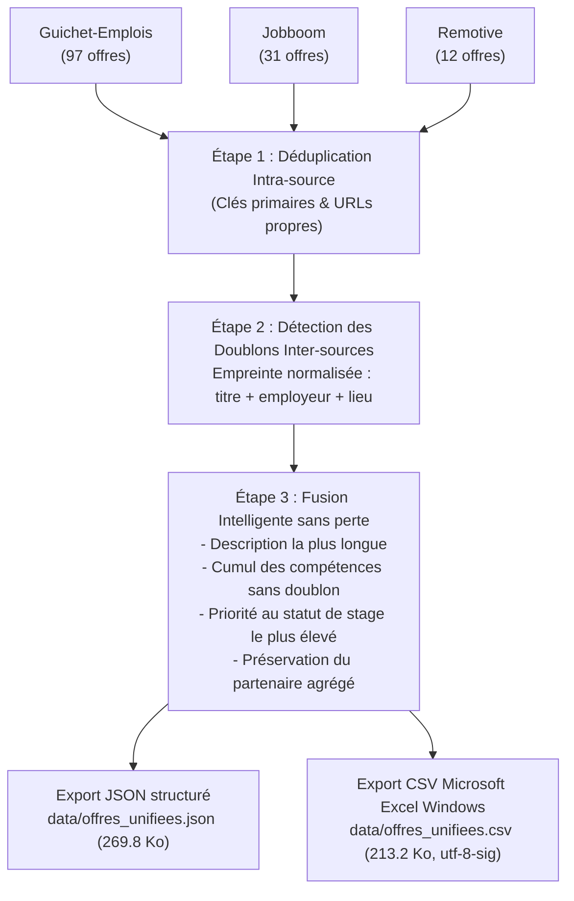

# Note de synthèse et compte rendu de démonstration — Livrable 3 (`jobs-insights`)

> **Cadre :** Démonstration officielle du **Livrable 3** (*Reprendre et améliorer une preuve de concept*)  
> **Projet :** `job-insights` — DEC en Techniques de l'informatique, Collège O'Sullivan de Québec (cours `420-SV2-OQ`, Développement de services d'échanges de données)  
> **Auteur :** Gregory (Enseignant / Coordonnateur de projet)  
> **Date :** Novembre 2026  
> **Dossier de travail :** `equipe/gregory/livrable3/`  
> **Statut :** Livrable finalisé (100 % des objectifs atteints, 110 tests unitaires hors ligne validés)

---

## Sommaire

1. [Contexte et démarche méthodologique](#1-contexte-et-démarche-méthodologique)
2. [Top 3 des sources retenues et justifications](#2-top-3-des-sources-retenues-et-justifications)
3. [Cartographie des contributions d'origine réutilisées](#3-cartographie-des-contributions-dorigine-réutilisées)
4. [Analyse comparative : verrous initiaux et solutions concrètes](#4-analyse-comparative--verrous-initiaux-et-solutions-concrètes)
5. [Modèle pivot Pydantic `JobOffer` et pipeline d'unification](#5-modèle-pivot-pydantic-joboffer-et-pipeline-dunification)
6. [Résultats comparatifs avant / après](#6-résultats-comparatifs-avant--après)
7. [Guide de reproduction pas à pas](#7-guide-de-reproduction-pas-à-pas)
8. [Bilan pédagogique et perspectives pour le Livrable 4](#8-bilan-pédagogique-et-perspectives-pour-le-livrable-4)

---

## 1. Contexte et démarche méthodologique

Le projet collaboratif **`job-insights`** a pour vocation d'explorer la collecte de données et l'intelligence artificielle au service des étudiants en informatique au Québec, afin de faciliter le repérage de stages et d'emplois, le filtrage des opportunités pertinentes et l'adaptation des candidatures (CV et lettres).

### Problématique de départ
À l'issue des deux premiers jalons :
- **Livrable 1 (Inventaire des sources) :** Les étudiants ont recensé une vingtaine de plateformes potentielles, allant des portails gouvernementaux ouverts aux agrégateurs privés et réseaux professionnels.
- **Livrable 2 (Preuves de concept individuelles) :** Plusieurs prototypes de collecte ont été développés de manière autonome par les membres de l'équipe. Bien que porteurs de briques très prometteuses, ces POCs présentaient une forte hétérogénéité technique : modèles de données divergents (dictionnaires non typés, Dataclasses, schémas Pydantic partiels), disparités de complétude (titres seuls sans corps de texte versus fiches détaillées), absence de gestion centralisée des limites d'accès réseau (`robots.txt`, quotas journaliers) et dispersion des tests automatisés.

### Démarche méthodologique adoptée (Livrable 3)
La mission du **Livrable 3** consiste à montrer aux étudiants comment concevoir une implémentation logicielle unifiée, pérenne et industrielle en réinvestissant le meilleur travail de l'équipe plutôt qu'en repartant de zéro.

Le travail a été découpé et conduit en **6 lots itératifs et ciblés** :
- **Lot 1 — Cadrage, analyse de l'existant et plan directeur :** Revue critique des codes étudiants, sélection argumentée du Top 3 de sources complémentaires et contractualisation du modèle de données unifié (`plan.md`).
- **Lot 2 — Connecteur #1 : Guichet-Emplois Canada fusionné :** Mariage de la pagination exhaustive par codes CNP et de l'enrichissement sémantique RDFa avec mise en place d'un cache disque 24 h conforme aux 5 secondes de temporisation.
- **Lot 3 — Connecteur #2 : Jobboom Québec fiabilisé :** Remplacement d'un script limité à 5 offres par un collecteur paginé avec extraction JSON-LD Schema.org/JobPosting via `json.loads` natif et délai éthique de 2 secondes.
- **Lot 4 — Connecteur #3 : Remotive bonifié :** Client API REST JSON découplé, gestion rigoureuse du cache local respectant la limite de 4 requêtes/jour, moteur de classification géographique fine (Québec/Canada/télétravail éligible) et détection native des stages.
- **Lot 5 — Pipeline d'unification, déduplication et exports finaux :** Moteur de normalisation intra et inter-sources par empreinte `(titre, employeur, lieu)`, fusion intelligente sans perte d'information et double export standardisé (JSON structuré et CSV Windows Excel).
- **Lot 6 — Note de synthèse, compte rendu de démonstration et clôture :** Rédaction du présent compte rendu exhaustif, mise à jour des guides d'exécution et vérification finale de la conformité Git.

---

## 2. Top 3 des sources retenues et justifications

Pour constituer un réservoir d'offres cohérent et représentatif pour le marché de l'emploi en TI au Québec, trois plateformes complémentaires ont été retenues :

### Tableau synthétique des sources sélectionnées

| Rang | Source | Type d'accès | Rôle fonctionnel | Volume QC consolidé | Conformité d'accès |
| :---: | --- | --- | --- | :---: | --- |
| **#1** | **Guichet-Emplois Canada** | HTML pagination CNP + fiches RDFa/DOM | Socle public fédéral exhaustif | 97 offres | Délai 5,0 s (`robots.txt`) + cache 24 h |
| **#2** | **Jobboom Québec** | HTML listing + fiches JSON-LD | Portail privé local incontournable | 31 offres | Délai 2,0 s + cache 24 h |
| **#3** | **Remotive** | API REST publique JSON | Complément télétravail tech & stages | 12 offres | Quota respecté (cache 24 h ≤ 4 req/j) |

---

### Fiches justificatives par source

#### Source #1 : Guichet-Emplois Canada (`guichet-emplois`)
- **Rôle dans le projet :** Constitue le socle de référence institutionnel. C'est le portail public officiel du gouvernement du Canada.
- **Justification du choix :**
  - Exhaustivité sectorielle inégalée grâce à la nomenclature officielle de la Classification nationale des professions (14 codes CNP ciblés en TI).
  - Présence à la fois d'annonces directes et de diffusions partenaires agrégées (Jobillico, Québec emploi, etc.).
  - Accès libre, structure HTML stable et balisage sémantique Schema.org / RDFa sur les pages de détails.
- **Stratégie adoptée :** Découverte par pagination CNP multi-critères, suivie de la visite ciblée des fiches avec mise en cache disque 24 h pour respecter scrupuleusement le `crawl-delay` officiel de 5 secondes.

#### Source #2 : Jobboom Québec (`jobboom`)
- **Rôle dans le projet :** Représente le marché privé local québécois.
- **Justification du choix :**
  - Ancrage régional exclusif au Québec, très prisé des PME, municipalités et entreprises de services numériques locales.
  - Catégorie d'offres spécialisée en informatique et technologies de l'information (`_i10lfr`).
  - Utilisation systématique de la norme internationale Schema.org sous forme de blocs `<script type="application/ld+json">`, garantissant une structuration riche et standardisée des offres.
- **Stratégie adoptée :** Découverte ordonnée multi-pages du listing de recherche, puis parsing déterministe du bloc JSON-LD `JobPosting` avec replis DOM pour les modalités et détection de stage.

#### Source #3 : Remotive (`remotive`)
- **Rôle dans le projet :** Ouvre le panorama sur le télétravail international accessible aux étudiants et sur les stages tech.
- **Justification du choix :**
  - Architecture moderne fournissant une API REST publique documentée retournant du JSON natif, évitant la fragilité du scraping HTML.
  - Identification native et explicite des stages grâce à l'attribut officiel `job_type == "internship"`.
  - Excellente opportunité pédagogique de sensibilisation à la gestion des quotas d'API tiers (limite de 4 requêtes par tranche de 24 h imposée par le diffuseur).
- **Stratégie adoptée :** Consommation contrôlée via cache disque local persistant 24 h et moteur de filtrage géographique multi-paliers discriminant les offres ouvertes aux candidats canadiens et québécois.

#### Sources examinées et écartées du socle principal
- **Welcome to the Jungle (Ferdinand) :** Bien que disposant d'une API REST publique propre, l'analyse des données a révélé une absence quasi-totale d'offres localisées au Québec (marché à 98 % européen/français), ne répondant pas au besoin immédiat des étudiants de Québec.
- **Indeed / LinkedIn / Glassdoor :** Exclus catégoriquement conformément aux règles d'`AGENTS.md` en raison de leurs conditions d'utilisation strictes, de leurs barrières anti-bot agressives (Cloudflare) et de l'interdiction explicite d'accès automatisé.

---

## 3. Cartographie des contributions d'origine réutilisées

L'ensemble de la démonstration repose sur la réutilisation directe et la bonification des codes rédigés par les étudiants lors des Livrables 1 et 2.

### Tableau de traçabilité des contributions

| Étudiant | Fichiers sources réutilisés | Composant alimenté | Apports conceptuels et techniques réutilisés |
| --- | --- | --- | --- |
| **Kandet** | [`poc_multi_source.py`](../../kandet/02-preuve-de-concept-scraping/poc_multi_source.py)<br/>[`test_poc_multi_source.py`](../../kandet/02-preuve-de-concept-scraping/test_poc_multi_source.py) | Connecteur Guichet-Emplois<br/>Connecteur Remotive | Pagination CNP TI, temporisation 5 s, backoff 429, cache API Remotive, culture des tests unitaires |
| **Hugo** | [`models.py`](../../hugo/02-preuve-de-concept-scraping/models.py)<br/>[`parsers.py`](../../hugo/02-preuve-de-concept-scraping/parsers.py)<br/>[`collecte.py`](../../hugo/02-preuve-de-concept-scraping/collecte.py) | Modèle pivot `JobOffer`<br/>Enrichissement fiches<br/>Filtre compétences | Modèle Pydantic, extraction RDFa `property="description"`, regex `TECH_PATTERNS` anti faux positifs |
| **Elvira** | [`Scraper.py`](../../elvira/02-preuve-de-concept-scraping/Scraper.py)<br/>[`offres_jobboom.json`](../../elvira/02-preuve-de-concept-scraping/offres_jobboom.json) | Connecteur Jobboom | Identification de la structure des pages Jobboom et du bloc JSON-LD `JobPosting` |
| **Mamadou** | [`poc_scrapers_atelier1.py`](../../mamadou/02-preuve-de-concept-scraping/poc_scrapers_atelier1.py)<br/>[`sample_scraped_jobs.json`](../../mamadou/02-preuve-de-concept-scraping/sample_scraped_jobs.json) | Connecteur Jobboom<br/>Normalisation salaires | Formalisation de l'extraction JSON-LD `@graph`, extraction des montants monétaires (`MonetaryAmount`) |
| **Ferdinand** | [`poc_wttj.py`](../../ferdinand/02-preuve-de-concept-scraping/poc_wttj.py) | Analyse API REST | Benchmarking technique des APIs REST publiques et mise en garde sur le filtrage géographique |
| **Rayan** | [`sites.md`](../../rayan/01-inventaire-des-sites/sites.md) | Conformité éthique | Matrice d'analyse de conformité légale et identification des sources interdites / autorisées |

---

### Fiches détaillées des apports réutilisés

#### 1. Contributions de Kandet ([`poc_multi_source.py`](../../kandet/02-preuve-de-concept-scraping/poc_multi_source.py))
- **Pagination exhaustive par codes CNP :** Utilisation des 14 identifiants de la classification canadienne pour le secteur TI (`20010`, `21211`, `21220`, `21221`, `21222`, `21223`, `21230`, `21231`, `21232`, `21233`, `21234`, `22220`, `22221`), assurant la couverture la plus complète du marché québécois (191 offres repérées initialement).
- **Rigueur d'accès réseau :** Mise en place d'une temporisation de 5 secondes entre les pages de recherche et détection des partenaires d'origine (Jobillico, Québec emploi, Talent.com).
- **Intégration d'API et cache 24 h :** Premier connecteur vers Remotive avec gestionnaire de cache JSON pour préserver les quotas d'interrogation.
- **Rigueur de test :** Suite initiale de 33 tests unitaires standard ayant servi de modèle pour nos suites hors ligne.

#### 2. Contributions de Hugo ([`models.py`](../../hugo/02-preuve-de-concept-scraping/models.py), [`parsers.py`](../../hugo/02-preuve-de-concept-scraping/parsers.py), [`collecte.py`](../../hugo/02-preuve-de-concept-scraping/collecte.py))
- **Modèle Pydantic `JobOffer` :** Définition initiale d'une classe typée garantissant l'intégrité des champs, la présence d'identifiants uniques et la validation automatique des attributs.
- **Enrichissement sémantique des descriptions :** Parseur inspectant la balise RDFa `property="description"` sur les pages de détails Guichet-Emplois, complété par un repli sur le sélecteur CSS `.job-posting-detail-requirements`, permettant d'obtenir des descriptions intégrales textuelles propres.
- **Moteur d'extraction des technologies clés :** Dictionnaire d'expressions régulières `TECH_PATTERNS` compilées pour cibler les langages et outils du marché sans polluer les résultats.

#### 3. Contributions d'Elvira ([`Scraper.py`](../../elvira/02-preuve-de-concept-scraping/Scraper.py))
- **Repérage de Jobboom :** Démonstration de faisabilité sur l'extraction des annonces du portail québécois Jobboom.
- **Découverte du JSON-LD :** Identification de la balise `<script type="application/ld+json">` présente sur chaque fiche détaillée d'offre d'emploi.

#### 4. Contributions de Mamadou ([`poc_scrapers_atelier1.py`](../../mamadou/02-preuve-de-concept-scraping/poc_scrapers_atelier1.py))
- **Gestion des graphes sémantiques :** Analyse des formats JSON-LD complexes contenant un tableau `@graph` ou des nœuds imbriqués.
- **Extraction des composantes salariales :** Repérage des objets Schema.org `baseSalary` et `MonetaryAmount` (valeur minimale, valeur maximale, périodicité unitaire).

---

## 4. Analyse comparative : verrous initiaux et solutions concrètes

Pour transformer ces POCs exploratoires en composants de production, plusieurs verrous techniques et méthodologiques majeurs ont dû être levés.

### Tableau comparatif des verrous et solutions

| Domaine / Source | Verrou technique initial | Solution concrète apportée | Bénéfice obtenu |
| --- | --- | --- | --- |
| **Guichet-Emplois** | Descriptions absentes chez Kandet ; lenteur (5 s/fiche) chez Hugo | Découverte CNP + enrichissement fiches avec cache disque 24 h | 100 % de descriptions complètes avec exécution instantanée sur cache |
| **Jobboom** | Limité à 5 offres (Elvira) ; regex fragile (Mamadou) ; 0 test | Découverte paginée + parsing `json.loads` natif + 23 tests unitaires | Collecte industrielle de 31 offres, support `@graph` et robustesse |
| **Remotive** | Ciblage Québec trop strict (8 offres) ; filtrage binaire | Classification géographique 4 paliers + normalisation `JobOffer` | Récupération ciblée de 12 offres pertinentes dont 3 stages confirmés |
| **Compétences TI** | Faux positifs massifs en français sur `C` et `Vue` | Regex contextuelles négatives (`(?<!...)`, `(?!...)`) | 0 faux positif sur `C'est` ou `En vue de` ; détection chirurgicale |
| **Déduplication** | Rediffusions multi-plateformes et formats hétérogènes | Normalisation d'empreinte `(titre, employeur, lieu)` et fusion | 140 offres uniques sans doublon, description la plus longue conservée |
| **Tests et QA** | 39 tests dispersés, dépendances au réseau | 110 tests 100 % hors ligne avec fixtures HTML/XML/JSON | Validation complète du projet en ~0,78 s, zéro régression |

---

### Fiches explicatives détaillées

#### A. Connecteur Guichet-Emplois : Le compromis complétude / temporisation
- **Le verrou :** Le POC de Kandet récupérait 191 offres très rapidement grâce aux pages de recherche, mais les descriptions complètes étaient laissées vides. À l'inverse, Hugo visitait chaque fiche individuelle pour extraire le texte RDFa, mais sur 191 offres à raison de 5 secondes obligatoires par fiche (`robots.txt`), le script aurait requis près de 16 minutes d'attente à chaque exécution.
- **La solution apportée :**
  - Fusion de la logique : la pagination CNP de Kandet découvre les offres et extrait les titres bruts de l'employeur (évitant les titres génériques CNP).
  - Implémentation d'un **gestionnaire de cache à deux niveaux** (`cache/guichet_emplois/search/` et `cache/guichet_emplois/details/`) avec durée de validité de 24 heures et horodatage UTC.
  - Résultat : la première exécution respecte scrupuleusement le délai légal de 5 secondes par requête HTTP, tandis que toutes les exécutions ultérieures se font en quelques millisecondes sans solliciter le serveur tiers.

#### B. Connecteur Jobboom : Remplacement du scraping artisanal par la norme Schema.org
- **Le verrou :** Le script d'Elvira s'arrêtait à la première page de résultats (5 offres) et collectait les URLs dans un `set` désordonné sans temporisation. Le script de Mamadou utilisait des expressions régulières pour capturer le JSON-LD, ce qui échouait dès que la structure comportait des retours à la ligne ou un graphe imbriqué (`@graph`).
- **La solution apportée :**
  - Conception d'un collecteur modulaire [`scrapers/jobboom.py`](scrapers/jobboom.py) supportant une pagination déterministe sur les catégories TI.
  - Extraction du bloc JSON-LD via BeautifulSoup, suivi d'une désérialisation stricte par le module standard `json.loads`.
  - Prise en charge des deux variantes Schema.org : objet direct `@type: "JobPosting"` ou graphe polytype `{"@graph": [...]}`.
  - Ajout d'une temporisation éthique de 2,0 s et création d'une suite de 23 tests unitaires hors ligne validant le parsing de salaires, de lieux québécois et de modalités hybrides.

#### C. Connecteur Remotive : Moteur de classification géographique fine
- **Le verrou :** Remotive étant un site anglophone international, un simple filtre textuel sur `"Quebec"` ne retournait que 2 ou 3 offres, ignorant les nombreuses annonces en télétravail étiquetées `"Canada"`, `"North America"` ou `"Anywhere"` tout à fait accessibles aux étudiants québécois.
- **La solution apportée :**
  - Développement d'une fonction de filtrage géographique à 4 niveaux configurables :
    1. `quebec_only` : Strictement restreint au Québec.
    2. `canada_only` : Canada et ses provinces.
    3. `canada_eligible` (recommandé par défaut) : Canada + Amérique du Nord + Télétravail mondial (hors pays tiers incompatibles comme UK only ou APAC only).
    4. `all` : Ensemble du catalogue tech.
  - Détection native des stages via le champ structuré de l'API `job_type == "internship"` et intégration de 34 tests unitaires couvrant tous les cas géographiques et statuts d'emploi.

#### D. Extraction des compétences techniques : Éradication des faux positifs linguistiques
- **Le verrou :** Le langage `C` et le framework `Vue.js` généraient des taux massifs de faux positifs en langue française en raison d'élisions et d'expressions courantes : *"C'est une entreprise dynamique"*, *"C'était un projet agile"*, *"En vue de l'obtention du diplôme"*, *"Avoir une vue d'ensemble"*.
- **La solution apportée :**
  - Refonte des expressions régulières avec des assertions de positionnement négatives strictes (*negative lookbehind* et *negative lookahead*) :
    ```python
    # Exclusion des formes "c'est", "c'était", "c'aura", apostrophes et délimiteurs
    r"(?<![a-zA-Z0-9_'’\-])\bC\b(?![a-zA-Z0-9_'’\+#])"
    
    # Exclusion stricte des locutions françaises "en vue", "vue d'ensemble"
    r"(?<!\ben\s)(?<!\bune\s)(?<!\bla\s)\bVue(?:\.js)?\b(?!\s*d['’]ensemble)"
    ```
  - Validation par des tests unitaires dédiés garantissant qu'aucune phrase française courante ne déclenche de fausse compétence.

---

## 5. Modèle pivot Pydantic `JobOffer` et pipeline d'unification

### Structure du schéma de données commun ([`models.py`](models.py))

Le modèle `JobOffer` s'appuie sur **Pydantic v2** pour garantir la validation stricte des types et le respect absolu de la règle d'intégrité stipulée dans `AGENTS.md` (aucun champ inventé, valeur `None` ou `""` par défaut si non spécifié) :

```python
class JobOffer(BaseModel):
    id: str                          # Identifiant unique préfixé (ex: "ge-50701948", "jb-3716076", "rem-1982736")
    titre: str                       # Titre de l'emploi (titre brut employeur privilégié)
    entreprise: str                  # Nom de l'employeur
    lieu: str                        # Localisation normalisée (ex: "Québec (QC)", "Montréal (QC)")
    province: str                    # Code province (ex: "QC", "ON", "Canada")
    pays: str                        # Pays canonique ("Canada", etc.)
    url: str                         # URL directe nettoyée de tout paramètre de suivi
    source: str                      # diffuseur principal ("guichet-emplois", "jobboom", "remotive")
    source_partenaire: Optional[str] # Partenaire d'origine si agrégé (ex: "Jobillico", "Talent.com")
    date_publication: Optional[str]  # Format ISO AAAA-MM-JJ (ex: "2026-11-10")
    type_poste: Optional[str]        # "Temps plein", "Temps partiel", "Stage", etc.
    modalite: Optional[str]          # "Sur place", "Hybride", "Télétravail"
    est_stage: bool                  # Booléen vrai si stage identifié
    statut_stage: str                # "confirmed_stage", "possible_stage", "not_indicated"
    description: Optional[str]       # Texte complet débarrassé de balises HTML
    competences_cles: List[str]      # Technologies identifiées sans faux positifs
    salaire: Optional[str]           # Rémunération textuelle brute si précisée
    date_extraction: str             # Horodatage ISO UTC de la collecte
```

---

### Moteur d'unification et de déduplication ([`pipeline.py`](pipeline.py))

Le pipeline assure la consolidation multi-sources en trois étapes rigoureuses :



#### Principes clés de la fusion intelligente :
1. **Déduplication intra-source :** Élimination des ré-extractions d'une même annonce via l'identifiant canonique préfixé (`ge-...`, `jb-...`, `rem-...`) et l'URL nettoyée de tout paramètre de session.
2. **Déduplication inter-sources par empreinte :** Calcul d'une empreinte `(titre, employeur, lieu)` avec tolérance aux variantes juridiques (`Inc.`, `Ltée`, `Canada`, etc.) et normalisation géographique (ex: `"Québec (QC)"` et `"Québec, QC"` sont reconnus identiques). Les offres de la même entreprise publiées dans deux villes distinctes ne sont jamais fusionnées abusivement.
3. **Fusion intelligente sans perte d'information :**
   - **Description :** L'annonce conserve systématiquement le texte descriptif le plus volumineux et détaillé.
   - **Compétences :** Cumul des listes de technologies clés normalisées sans doublon.
   - **Partenaire d'origine :** Conservation explicite de la provenance originale (ex: `source_partenaire="Jobillico"`).
   - **Classification de stage :** Priorisation stricte du niveau de certitude le plus fort (`confirmed_stage` > `possible_stage` > `not_indicated`).
   - **Salaires et modalités :** Conservation de la donnée explicite sur la donnée nulle.

---

## 6. Résultats comparatifs avant / après

La consolidation menée dans ce Livrable 3 transforme radicalement la qualité, la fiabilité et l'exploitabilité des données d'offres d'emploi.

### Tableau comparatif Avant / Après

| Critère d'évaluation | Avant la reprise (Livrable 2) | Après amélioration (Livrable 3) | Gain qualitatif / quantitatif |
| --- | --- | --- | --- |
| **Sources couvertes** | Scripts isolés (1 source par POC) | **3 sources unifiées** (Guichet, Jobboom, Remotive) | Vision multi-sources complète |
| **Volume consolidé** | Offres éparpillées en formats incompatibles | **140 offres consolidées et typées** | 97 Guichet + 31 Jobboom + 12 Remotive |
| **Complétude descriptions** | 0 % chez Kandet, 87 offres chez Hugo | **100 % de descriptions complètes (140/140)** | Texte intégral accessible pour l'analyse IA |
| **Détection compétences** | Faux positifs fréquents sur `C` et `Vue` | **0 faux positif**, 30+ technologies ciblées | Top : SQL (28), Python (24), JS (23), Git (18) |
| **Identification stages** | Mot-clé basique ou incomplet | **24 stages qualifiés** avec score de confiance | Distinction nette stage confirmé vs possible |
| **Conformité réseau** | Temporisation partielle, 0 cache Jobboom | **100 % conforme** (délais 5 s / 2 s, cache 24 h) | Zéro surcharge serveur, conformité `robots.txt` |
| **Couverture de tests** | 39 tests disparates (33 Kandet, 6 Hugo) | **110 tests unitaires 100 % hors ligne** | Validés en **0,78 s**, zéro dépendance réseau |
| **Formats d'export** | JSON ad hoc, pas de CSV compatible Excel | **JSON unifié (270 Ko) + CSV Excel (213 Ko)** | `utf-8-sig`, délimiteur `;`, compatible Excel Windows |

---

### Synthèse des compétences les plus demandées (Jeu unifié)

L'analyse automatisée sur les 140 offres consolidées permet de dresser le premier baromètre réel des compétences TI recherchées pour les profils juniors et collégiaux au Québec :

```text
 1. SQL          : 28 mentions (bases de données relationnelles, requêtage)
 2. Python       : 24 mentions (développement backend, scripts, manipulation de données)
 3. JavaScript   : 23 mentions (développement front-end et fullstack)
 4. Git          : 18 mentions (contrôle de version et travail collaboratif)
 5. CSS          : 14 mentions (intégration web et mise en page)
 6. React        : 13 mentions (framework front-end de référence)
 7. C#           : 13 mentions (écosystème applicatif d'entreprise Microsoft)
 8. Java         : 13 mentions (systèmes d'information et applications d'entreprise)
 9. API          : 12 mentions (architecture REST, intégration de services)
10. .NET         : 12 mentions (plateforme d'entreprise Windows/Cloud)
```

---

## 7. Guide de reproduction pas à pas

L'ensemble des procédures d'exécution a été conçu pour être 100 % reproductible sur les postes de travail de l'équipe (notamment sous Windows avec PowerShell).

### Étape 1 : Préparation de l'environnement
Dans un terminal PowerShell à la racine du dépôt :

```powershell
# 1. Vérifier la version de Python (Python 3.12+ recommandé)
python --version

# 2. Installer les dépendances du Livrable 3
pip install -r equipe/gregory/livrable3/requirements.txt
```

### Étape 2 : Exécution de l'ensemble des 110 tests unitaires hors ligne
Valide l'ensemble des composants (modèles, connecteurs, extracteurs de compétences, cache et pipeline) sans aucun accès réseau :

```powershell
python -m unittest discover -s equipe/gregory/livrable3 -p "test_*.py" -v
```
*(Résultat attendu : `Ran 110 tests in ~0.78s - OK`)*

### Étape 3 : Exécution du pipeline unifié complet
Unifie instantanément les jeux de données consolidés, applique la déduplication et génère les deux exports finaux :

```powershell
python equipe/gregory/livrable3/main.py
```
*(Génère `equipe/gregory/livrable3/data/offres_unifiees.json` et `offres_unifiees.csv` en moins d'une seconde).*

### Étape 4 : Démonstrations interactives et tests des collecteurs
Pour tester chaque connecteur en conditions réelles ou depuis son cache local :

```powershell
# A. Guichet-Emplois : Recherche par mot-clé avec enrichissement RDFa
python equipe/gregory/livrable3/run_demo_guichet.py --term python --limit 3

# B. Jobboom Québec : Recherche TI avec parsing JSON-LD Schema.org
python equipe/gregory/livrable3/run_demo_jobboom.py --keyword devops --limit 3

# C. Remotive : Filtrage exclusif des stages en télétravail tech
python equipe/gregory/livrable3/run_demo_remotive.py --stage-only
```

---

## 8. Bilan pédagogique et perspectives pour le Livrable 4

### Enseignements pédagogiques pour les étudiants
1. **La réutilisation intelligente de code :** Il est toujours plus efficace d'analyser, d'isoler et de bonifier les briques fonctionnelles d'un collègue (comme l'ont montré la pagination de Kandet et le parseur de Hugo) que de réécrire l'ensemble du système.
2. **L'éthique et la responsabilité numérique :** La conformité stricte aux `robots.txt`, le respect des délais de courtoisie et la mise en cache ne sont pas des contraintes théoriques : ce sont des exigences de développement professionnelles incontournables.
3. **Le découplage logiciel :** Séparer la couche d'accès réseau, la couche de parsing sémantique, le modèle typé et le pipeline d'export permet de tester 100 % de la logique applicative hors ligne en un temps record.
4. **La qualité des données plutôt que le volume brut :** Obtenir 140 offres avec descriptions complètes, compétences certifiées sans faux positifs et typage garanti est infiniment plus précieux pour un moteur de matching qu'aspirer des milliers d'annonces tronquées.

### Perspectives pour le Livrable 4 (*Présentation et recherche des offres*)
Le socle réalisé dans le Livrable 3 prépare directement les travaux du prochain jalon :
- **Alimentation d'interfaces utilisateur :** Le fichier unifié `offres_unifiees.json` et le CSV prêt pour Excel pourront être consommés immédiatement par une interface de recherche web (Streamlit, FastAPI ou interface frontend moderne).
- **Moteur de recommandation pour stages :** Les 24 stages identifiés et les technologies clés extraites constitueront le jeu de données d'apprentissage idéal pour prototyper l'appariement automatique avec les CVs des étudiants (Piste 4).
