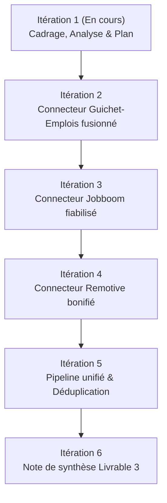

# Plan directeur de démonstration — Livrable 3 (`jobs-insights`)

> **Cadre :** Démonstration modèle du **Livrable 3** (*Reprendre et améliorer une preuve de concept*)  
> **Auteur :** Gregory (Enseignant / Coordonnateur de projet)  
> **Dossier de travail :** `equipe/gregory/livrable3/`  
> **Méthode de travail :** 1 conversation par lot / itération pour préserver le contexte et les tokens. À la fin de chaque lot : proposition de commit Git + prompt de démarrage du lot suivant + recommandation de modèle.

---

## 1. Contexte et objectifs de la démonstration

Dans le cadre du projet collaboratif **`job-insights`** (DEC en Techniques de l'informatique, Collège O'Sullivan de Québec), ce plan structure la réalisation d'une démonstration exemplaire du **Livrable 3**.

### Objectifs pédagogiques et techniques
1. **Montrer la démarche de reprise de code :** Analyser objectivement les contributions existantes des étudiants (Livrable 1 et Livrable 2), identifier ce qui fonctionne déjà et cibler les verrous à lever.
2. **Sélectionner un Top 3 de sources complémentaires :** Choisir 3 plateformes pertinentes pour les étudiants en TI au Québec, combinant différents modes d'accès techniques (HTML/RDFa, JSON-LD, API REST).
3. **Produire une implémentation de référence :**
   - Fusionner et perfectionner les meilleures briques techniques développées par l'équipe.
   - Garantir une conformité réseau irréprochable (`robots.txt`, temporisation, `User-Agent` transparent).
   - Découpler strictement la collecte réseau, le parsing, le typage et l'export.
   - Couvrir l'ensemble de la logique par des **tests unitaires 100 % hors ligne**.
   - Déboucher sur un schéma de données commun et un pipeline de déduplication multi-sources.

---

## 2. Analyse critique de l'existant (Scraping L1 & L2)

### Tableau de synthèse des contributions analysées

| Contributeur | Source(s) testée(s) | Méthode d'accès | Données obtenues | Tests unitaires | Statut technique |
| --- | --- | --- | --- | --- | --- |
| **Kandet** | Guichet-Emplois, Remotive | HTML pagination CNP, API JSON | 191 offres QC + 8 Remotive | 33 tests hors ligne | Robuste (`stdlib` pure, délais stricts) |
| **Hugo** | Guichet-Emplois | Cascade Atom, HTML, RDFa/DOM | 87 offres QC enrichies | 6 tests hors ligne | Très riche (Pydantic, descriptions 100 %) |
| **Elvira** | Jobboom | HTML SSR + JSON-LD | 5 offres QC complètes | Aucun test | Fonctionnel mais limité à la page 1 |
| **Mamadou** | Talent.com, Jobboom, Guichet, Jobillico | JSON-LD `@graph`, RDFa, regex | 10 offres multi-sources | Aucun test | Multi-source prometteur mais parsing regex fragile |
| **Ferdinand** | Welcome to the Jungle | API REST publique JSON | 30 offres (CSV) | Aucun test | Fonctionnel techniquement mais hors cible Québec |
| **Dan** | Guichet-Emplois | HTML SSR (Moncton) | Aucune sortie | Aucun test | Incomplet (sélecteurs non confirmés, conflit Git) |

---

### Fiches d'analyse par contribution

#### Guichet-Emplois — Kandet (`poc_multi_source.py`)
- **Ce qui marche très bien :**
  - Pagination exhaustive sur 14 codes CNP du secteur TI au Québec, atteignant **191 offres uniques**.
  - Respect scrupuleux des 5 secondes de délai (`robots.txt`) et gestion du backoff sur `HTTP 429`.
  - Détection automatique des plateformes partenaires d'origine (Jobillico, Québec emploi, Talent.com, etc.).
  - Moteur de déduplication inter-sources par empreinte (`titre` + `employeur` + `lieu`).
  - 100 % bibliothèque standard Python (`urllib`, `html.parser`, `dataclasses`) avec 33 tests unitaires hors ligne validés en 0,2 s.
- **Limites observées :**
  - Collecte restreinte au niveau de la page de recherche (pas de visite des fiches individuelles).
  - Titres issus des libellés officiels de la CNP plutôt que des titres bruts de l'employeur (ce qui limite la détection des stages dans les intitulés).
  - Descriptions textuelles complètes et exigences détaillées non extraites (laissées vides).

#### Guichet-Emplois — Hugo (`models.py`, `parsers.py`, `collecte.py`)
- **Ce qui marche très bien :**
  - Extraction sémantique sur fiches détaillées via balises RDFa / Schema.org (`property="description"`) avec repli DOM.
  - Récupération à **100 % des descriptions intégrales** nettoyées de balises HTML.
  - Détection de compétences techniques par regex contextuelles (`TECH_PATTERNS`) éliminant les faux positifs récurrents en français (`C` et `Vue`).
  - Architecture modulaire claire et schéma typé Pydantic `JobOffer`.
  - 6 tests unitaires hors ligne (23 assertions) validés en 0,01 s.
- **Limites observées :**
  - Recherche basée sur une liste fixe de 16 mots-clés plutôt que sur une pagination exhaustive des codes CNP.
  - La visite systématique des 191 fiches à 5 s/fiche nécessiterait ~16 minutes d'attente (besoin d'une politique de cache ou d'enrichissement par lot).

#### Jobboom — Elvira & Mamadou (`Scraper.py` & `poc_scrapers_atelier1.py`)
- **Ce qui marche très bien :**
  - Présence d'un bloc JSON-LD `@type: "JobPosting"` complet et standardisé sur chaque fiche d'offre.
  - Ancrage 100 % québécois avec catégories dédiées TI / médias numériques.
- **Limites observées :**
  - Elvira limite l'extraction à la 1re page (5 offres) et utilise un `set` non ordonné pour les liens.
  - Mamadou extrait le JSON-LD avec des expressions régulières au lieu de parseurs dédiés.
  - Absence de pagination, pas de tests unitaires hors ligne, et temporisation à formaliser (2 à 3 s).

#### Remotive — Kandet (`poc_multi_source.py`)
- **Ce qui marche très bien :**
  - API REST publique propre retournant des données nativement typées en JSON.
  - Identification sans ambiguïté des stages via l'attribut officiel `job_type=internship`.
  - Mécanisme de cache local 24 h (`remotive-cache.json`) respectant la limite stricte de 4 requêtes/jour.
- **Limites observées :**
  - Volume restreint pour les postes basés strictement au Québec (dominante télétravail Canada / International).

#### Welcome to the Jungle — Ferdinand (`poc_wttj.py`)
- **Ce qui marche très bien :**
  - Accès direct via l'API REST publique `/api/v3/public/jobs` sans parsing HTML.
- **Limites observées :**
  - Cible presque exclusivement européenne / américaine dans les résultats actuels (0 offre identifiée au Québec).
  - Localisation (`office`/`offices`) non extraite dans le fichier CSV exporté.
  - Dépendance à un appel Windows-only `os.startfile()`.

---

## 3. Sélection argumentée du Top 3 des sites à scraper

Pour constituer un panorama représentatif, robuste et légalement irréprochable, les 3 sources suivantes sont retenues pour la démonstration :

### Synthèse comparative du Top 3

| Rang | Source cible | Méthode technique | Rôle dans le projet | Volume attendu (QC) |
| :---: | --- | --- | --- | :---: |
| **#1** | **Guichet-Emplois Canada** | HTML pagination CNP + fiches RDFa/DOM | Socle public officiel exhaustif | 150 à 200+ offres |
| **#2** | **Jobboom Québec** | HTML listing + fiches JSON-LD | Portail d'emploi local québécois | 20 à 50+ offres |
| **#3** | **Remotive** | API REST JSON + cache local | Complément télétravail & stages TI | 10 à 30 offres |

*(Alternative possible pour le site #3 selon orientation pédagogique : **Talent.com Canada** pour explorer le format JSON-LD `@graph` avec géolocalisation, ou **Adzuna Canada** avec clé API).*

---

### Fiches justificatives des sources retenues

#### Site #1 : Guichet-Emplois Canada (Priorité absolue — Socle commun)
- **Pourquoi ce choix :** C'est le portail public le plus complet au Canada, recensant à la fois les offres directes et celles de partenaires majeurs (Jobillico, Québec emploi, etc.).
- **Stratégie de bonification pour la démo :**
  - Reprendre la pagination exhaustive par codes CNP de **Kandet** pour la découverte complète des offres sans plafond.
  - Intégrer le moteur d'extraction RDFa, le repli DOM et le filtre de compétences de **Hugo** pour enrichir le détail des annonces.
  - Mettre en place un cache local des fiches pour respecter le `crawl-delay` de 5 s sans ralentir les exécutions successives.

#### Site #2 : Jobboom Québec (Portail privé local incontournable)
- **Pourquoi ce choix :** C'est une référence locale majeure pour les PME et institutions québécoises qui ne publient pas toutes sur les plateformes fédérales.
- **Stratégie de bonification pour la démo :**
  - Reprendre l'analyse JSON-LD initiée par **Elvira** et **Mamadou**.
  - Remplacer le parcours partiel de la page 1 par une pagination ordonnée et paramétrable.
  - Extraire proprement le bloc `<script type="application/ld+json">` avec `json.loads` et parseur HTML.
  - Implémenter une temporisation respectueuse (2 s entre les pages) et des tests unitaires hors ligne sur fixtures HTML.

#### Site #3 : Remotive (Spécialiste du télétravail tech et des stages)
- **Pourquoi ce choix :** Il illustre l'intégration élégante d'une API REST JSON sans scraping HTML fragile, avec un repérage parfait des stages (`internship`) et du télétravail.
- **Stratégie de bonification pour la démo :**
  - Reprendre le connecteur et le système de cache 24 h de **Kandet**.
  - Améliorer le filtrage géographique pour cibler les offres ouvertes au Canada / Québec.
  - Normaliser la sortie vers le même modèle unifié que Guichet-Emplois et Jobboom.

---

## 4. Schéma de données pivot unifié (`JobOffer`)

Pour garantir l'interopérabilité des trois collecteurs, chaque scraper produira des objets conformes à un modèle partagé (Pydantic ou Dataclass standard) :

```python
@dataclass  # ou BaseModel Pydantic
class JobOffer:
    id: str                        # Identifiant unique normalisé (ex: "ge-12345", "jb-67890", "rem-1122")
    titre: str                     # Intitulé du poste
    entreprise: str                # Nom de l'employeur
    lieu: str                      # Ville / Région (ex: "Québec, QC", "Montréal, QC")
    province: str                  # Province normalisée (ex: "QC")
    url: str                       # Lien direct vers l'offre
    source: str                    # Nom du portail ("guichet-emplois", "jobboom", "remotive")
    source_partenaire: Optional[str] # Partenaire d'origine si agrégé (ex: "Jobillico", "Québec emploi")
    date_publication: Optional[str]# Date au format ISO AAAA-MM-JJ
    type_poste: Optional[str]      # "Temps plein", "Temps partiel", etc.
    modalite: Optional[str]        # "Sur place", "Hybride", "Télétravail"
    est_stage: bool                # True si stage identifié, False sinon
    statut_stage: str              # "confirmed_stage", "possible_stage", "not_indicated"
    description: Optional[str]     # Texte complet nettoyé de balises HTML
    competences_cles: List[str]    # Liste de technologies / compétences détectées
    salaire: Optional[str]         # Rémunération si mentionnée (ou None)
```

> **Règle d'intégrité (stipulée dans `AGENTS.md`) :**  
> Tout champ absent d'une offre reste à `None` ou `""`. Les valeurs non précisées ne sont jamais devinées.

---

## 5. Feuille de route par itérations (Plan multi-conversations)

Pour éviter la saturation de la fenêtre de contexte et préserver les jetons, la démonstration est segmentée en **6 itérations indépendantes et séquentielles**. Chaque nouvelle session s'appuiera sur le présent document pour reprendre immédiatement le travail.



---

### Itération 1 — Cadrage, analyse de l'existant et plan directeur *(✅ Terminée)*
- [x] Examiner les codes de l'équipe (Hugo, Kandet, Elvira, Mamadou, Ferdinand, Dan).
- [x] Dresser le bilan des forces et faiblesses techniques.
- [x] Sélectionner et justifier le Top 3 des sites (Guichet-Emplois, Jobboom, Remotive).
- [x] Définir le modèle de données unifié (`JobOffer`).
- [x] Rédiger le plan directeur repère dans `equipe/gregory/livrable3/plan.md`.
- [x] Valider les orientations avec Gregory (choix du site 3, stack de dépendances).

---

### Itération 2 — Connecteur #1 : Guichet-Emplois fusionné & enrichi *(✅ Terminée)*
- [x] Créer l'architecture du module dans `equipe/gregory/livrable3/scrapers/guichet_emplois.py`.
- [x] Importer la pagination exhaustive par codes CNP de Kandet (découverte complète).
- [x] Intégrer l'enrichissement RDFa / DOM et le parseur de compétences de Hugo.
- [x] Mettre en place un cache local des fiches pour respecter le `crawl-delay` de 5 s.
- [x] Écrire la suite de tests unitaires hors ligne (`test_guichet_emplois.py`).
- [x] Valider l'exécution et produire un jeu d'essai `data/offres_guichet_emplois.json`.

---

### Itération 3 — Connecteur #2 : Jobboom Québec fiabilisé *(✅ Terminée)*
- [x] Créer le module dans `equipe/gregory/livrable3/scrapers/jobboom.py`.
- [x] Structurer la découverte des URLs avec pagination ordonnée (surpassant la limite de 5 offres).
- [x] Implémenter l'extraction robuste du JSON-LD `JobPosting` sans regex fragile.
- [x] Intégrer la temporisation conforme (pause de 2 s entre requêtes).
- [x] Écrire la suite de tests unitaires hors ligne avec fixtures HTML locales (`test_jobboom.py`).
- [x] Valider l'exécution et produire un jeu d'essai `offres_jobboom.json`.

---

### Itération 4 — Connecteur #3 : Remotive bonifié *(✅ Terminée)*
- [x] Créer le module dans `equipe/gregory/livrable3/scrapers/remotive.py`.
- [x] Adapter le client API REST avec cache local 24 h (`cache/remotive/remotive_cache.json`).
- [x] Améliorer le filtre géographique multi-niveaux (Canada / Québec / télétravail éligible).
- [x] Aligner les sorties sur le modèle de données unifié `JobOffer` (détection native stages `internship`).
- [x] Écrire la suite de 34 tests unitaires hors ligne (`test_remotive.py`).
- [x] Valider l'exécution et produire le jeu d'essai `data/offres_remotive.json` (12 offres).

---

### Itération 5 — Pipeline d'unification, déduplication et export
- [ ] Créer le point d'entrée unifié `equipe/gregory/livrable3/main.py`.
- [ ] Implémenter le moteur de déduplication multi-sources :
  - Déduplication intra-source par identifiant unique / URL.
  - Déduplication inter-sources par empreinte normalisée (`titre` + `employeur` + `lieu`).
  - Détection et conservation des sources partenaires (ex: offre Guichet-Emplois provenant de Jobillico).
- [ ] Fournir deux formats d'export complets :
  - `data/offres_unifiees.json` (format structuré complet avec descriptions et compétences).
  - `data/offres_unifiees.csv` (encodé en `utf-8-sig` avec séparateur `;` pour compatibilité Excel).
- [ ] Écrire les tests unitaires du pipeline de fusion (`test_pipeline.py`).

---

### Itération 6 — Compte rendu de démonstration et note de synthèse
- [ ] Rédiger la note de démonstration du Livrable 3 dans `equipe/gregory/livrable3/COMPTE_RENDU.md`.
- [ ] Documenter explicitement :
  - Le site principal choisi et les contributions réutilisées (avec liens vers les fichiers de Kandet, Hugo, Elvira, Mamadou).
  - Ce qui a fonctionné, les limites initiales et les améliorations apportées.
  - La commande exacte de reproduction et le résultat comparatif avant/après.
- [ ] Fournir un guide d'exécution rapide pour les étudiants (`README.md`).

---

## 6. Matrice de suivi d'avancement de la démo

| Étape / Module | Responsable | Statut | Fichiers associés | Tests validés |
| --- | --- | :---: | --- | :---: |
| **Plan directeur L3** | Gregory / IA | ✅ Terminé | `equipe/gregory/livrable3/plan.md` | S/O |
| **Modèle unifié `JobOffer`** | Gregory / IA | ✅ Terminé | `models.py` | 2 tests |
| **Connecteur Guichet-Emplois** | Gregory / IA | ✅ Terminé | `scrapers/guichet_emplois.py` | 24 tests (0,03 s) |
| **Connecteur Jobboom** | Gregory / IA | ✅ Terminé | `scrapers/jobboom.py` | 23 tests (0,03 s) |
| **Connecteur Remotive** | Gregory / IA | ✅ Terminé | `scrapers/remotive.py` | 34 tests (0,05 s) |
| **Pipeline & Déduplication** | Gregory / IA | ⏳ À démarrer | `pipeline.py`, `main.py` | 0 test |
| **Exports JSON / CSV** | Gregory / IA | ⏳ En cours | `data/offres_guichet_emplois.json`, `data/offres_jobboom.json`, `data/offres_remotive.json` | 97 GE + 31 JB + 12 REM |
| **Compte rendu Livrable 3** | Gregory / IA | ⏳ À démarrer | `COMPTE_RENDU.md` | S/O |

---

## 7. Règles techniques et bonnes pratiques obligatoires

Conformément à [`AGENTS.md`](../../../AGENTS.md) :
1. **Zéro appel réseau pendant les tests :** Tous les tests unitaires doivent s'exécuter hors ligne à l'aide de chaînes fictives ou de fichiers de fixtures locaux.
2. **Conformité stricte :** Respecter les `robots.txt` et les délais préconisés (5 s sur Guichet-Emplois, 2 s sur Jobboom, cache 24 h sur Remotive).
3. **Encodage Windows & multiplateforme :**
   - Toujours spécifier `encoding="utf-8"` lors de la lecture/écriture de fichiers.
   - Utiliser `utf-8-sig` pour les exports CSV destinés à être ouverts sous Microsoft Excel sur Windows.
4. **Zéro hallucination sur les données :** Si un champ n'est pas présent sur la fiche source, il reste `None` ou `""`.
5. **Gestion saine des dépendances :** Documenter clairement les prérequis dans un `requirements.txt` dédié et ne jamais utiliser d'auto-installation silencieuse `pip` à l'import.
